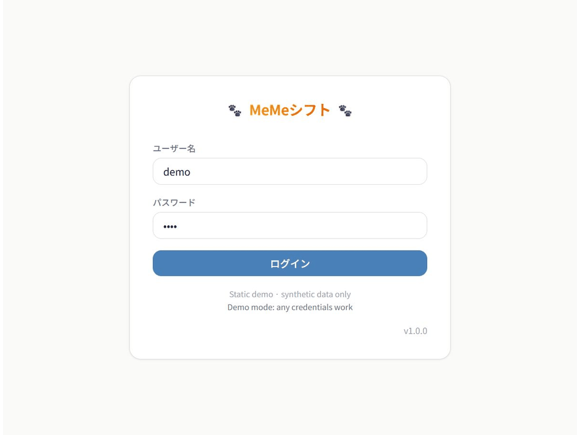
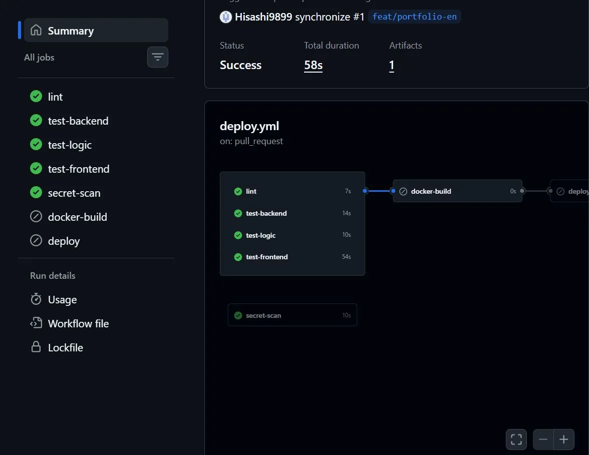
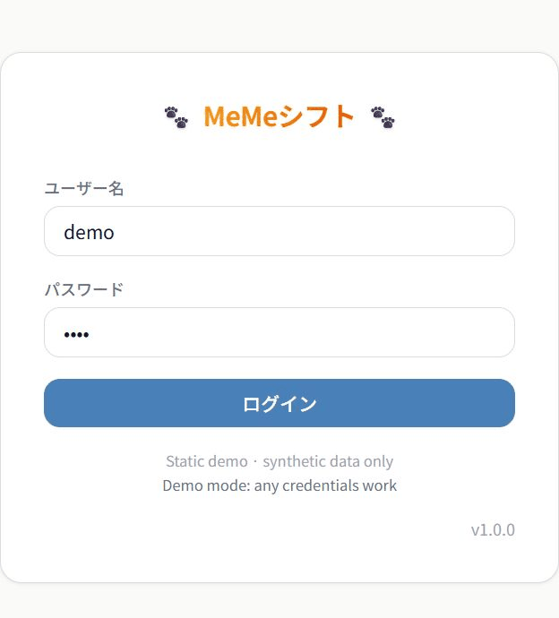

# memeShift

[English](README.md) | **日本語**

医療従事者向けのシフト自動作成 Web アプリケーションです。
スタッフの希望休・勤務条件・必要人数・相性ルールを入力すると、夜勤→明け→休みの連鎖や連勤上限といった現場固有の制約を考慮した勤務表を生成します。

**1人・MVP 2週間（最速記録）／標準4〜6週間で、フロントエンドからスケジューリングエンジン、Docker、CIまで一貫構築。**

このリポジトリは技術評価用のサニタイズ済みスナップショットです。実運用の設定・ドメイン・認証情報・個人情報は含まれていません。

---

## スクリーンショット / デモ

[静的デモを開く](https://hisashi9899.github.io/memeShift-portfolio/) — 合成データのみのクライアントサイドデモです。アカウント・API・DBは不要です（ログインは任意の認証情報で通ります）。

<p align="center">
  
</p>

<p align="center">
  
  <br>
  <sub>CI（lint / backend / logic / frontend / secret scan）成功。PR では Docker build と deploy はスキップされます。</sub>
</p>

スクリーンショットは `Staff A` 〜 `Staff J` の合成データで撮影しています。実在のスタッフ・施設・メール・電話・住所は含まれません。

---

## なぜ異例か

一般的なシフト管理デモは「入力フォーム＋表」で終わりますが、本作は制約が衝突する場面を扱います。

- **夜勤連鎖** — 夜勤の翌日は明け、その翌日は休み。
- **公平性** — 夜勤回数・早番/遅番の偏り・公休数・希望達成率を年間で評価。
- **説明可能性** — 生成不可時に、日付・勤務種別・必要人数/割当人数・原因を提示。
- **静かな書き換えをしない** — 局所修復と崩しルートを提示し、適用は明示的な確認操作のみ。

### 小さな心遣い

ログインカードの四隅をクリックすると、背景画像をお好みの画像に変更できます。長時間勤務で心身の負担が大きい看護師・介護士の方に、勤務表を開く前の小さな息抜きを届けたいという意図で入れました。画像はブラウザの `localStorage` にのみ保存され、サーバーには送信されません。

<p align="center">
  
</p>

### 1人で届けた範囲 — 最速記録と標準見積もり

| 領域 | 内容 |
|---|---|
| API | REST 43エンドポイント、ドメインサービス14本、Sanctum認証 |
| フロントエンド | 6画面、23コンポーネント、TypeScript/TSX 4,100行以上 |
| エンジン | 37KBのスタンドアロンPHPエンジン（Laravel非依存）、PHPUnit 4テスト |
| データ | マイグレーション15本、MySQL 8 |
| インフラ | Docker Compose、Nginx、GitHub Actions、GitHub Pages静的デモ |
| 品質 | PHP lint、backend/engine PHPUnit、TypeScript、Next build、gitleaks |

> 行数そのものが価値ではありません。同じ1人がドメインモデルを設計し、エンジンを書き、UIを届け、配信パイプラインまで整えたことが要点です。

### 期間の目安 — 最速記録と標準見積もり

| 区分 | MVP | 本番 + CI/CD |
|---|---|---|
| **最速記録（memeShift）** | **2週間** | **1ヶ月 / 1.5ヶ月** |
| **標準見積もり** | **4〜6週間** | **10〜14週間** |
| 複雑な連携・コンプライアンス | 6〜8週間 | 16週間以上 |

> 2週間MVPは、スコープを絞り、ドメイン知識があり、フルタイム勤務の傍ら終業後・休日に開発した特殊な記録です。通常のお見積もりは、MVP 4〜6週間、本番+CI/CD 10〜14週間を目安にしています。

### 2分で試す

1. 静的デモを開く（認証情報は任意）
2. **勤務自動作成** を押し、違反パネルを確認
3. **統計** で負担・公平性・安全性・成長の指標を確認
4. **希望入力** で希望休・固定シフトの登録を確認

> 勤務表はデスクトップ表示に最適化しています。ランディングページとログインはレスポンシブ対応です。

---

## 主な機能

| 機能 | 概要 |
|------|------|
| スタッフ管理 | 勤務可能日、雇用形態、スキル、ソート順の一括編集 |
| シフト種別 | 日勤・早番・遅番・夜勤・明けなどの時刻・色定義 |
| 必要人数設定 | シフト種別 × 曜日/日付ごとの必要人数、日別上書き |
| 希望休・希望シフト | スタッフごとの休み希望・固定シフト |
| 相性ルール | 同時勤務の可否（組み合わせ禁止） |
| 自動生成 | 制約充足 + 公平性評価による月次勤務表の生成 |
| 自動修正 | 違反箇所の局所修復、崩しルートの探索・適用 |
| 分析 | サマリ、タイムライン、制約違反一覧、年次・成長統計 |
| エクスポート | CSV / PDF（IPA フォントによる日本語出力） |
| 失敗理由の説明 | 生成不可時に不足条件を自然言語で提示 |

---

## アーキテクチャ

```
┌──────────────┐   HTTP    ┌──────────────┐   FastCGI   ┌──────────────────┐
│  Next.js 14  │ ────────▶ │    Nginx     │ ──────────▶ │  Laravel 10      │
│  (TypeScript)│           │              │             │  (PHP 8.2)       │
└──────────────┘           │              │             │  Interface層      │
                           │              │             │  Service層        │
                           │              │             └────────┬─────────┘
                           │              │                      │
                           │              │             ┌────────▼─────────┐
                           │              │             │  MySQL 8         │
                           └──────────────┘             └──────────────────┘
                                        │
                              ┌─────────▼──────────┐
                              │ logic (PHP CLI)     │
                              │ 依存ゼロの生成エンジン │
                              └────────────────────┘
```

- **frontend/** — Next.js 14 (App Router) + TypeScript + Tailwind CSS
- **backend/** — Laravel 10。`app/Interface/Controllers` に HTTP 層、`app/Services` にドメインサービスを配置
- **logic/** — Laravel に依存しない単体実行可能なスケジューリングエンジン（`logic/src/ScheduleEngine.php`）
- **shared/** — backend と logic が共有する DTO（Composer path repository）
- **docker/** — Laravel / Next.js / logic の Dockerfile と Nginx 設定

### ディレクトリ構成

```
.
├── backend/                 Laravel アプリケーション
│   ├── app/
│   │   ├── Interface/       Controller / Request / Resource
│   │   ├── Services/        生成・分析・修復・エクスポート
│   │   └── Models/          Eloquent モデル
│   ├── database/            migrations / seeders
│   ├── routes/api.php       REST API
│   └── tests/               PHPUnit
├── frontend/                Next.js アプリケーション
│   ├── src/app/             login / dashboard / settings / preferences / statistics / growth
│   ├── src/components/      UI コンポーネント
│   └── e2e/                 Playwright E2E
├── logic/                   スタンドアロン生成エンジン
│   ├── src/ScheduleEngine.php
│   └── tests/               等価性テスト
├── shared/                  共有 DTO
├── docker/                  Dockerfile / Nginx 設定
└── docker-compose.yml
```

---

## スケジューリングの設計

生成は「制約充足による構築」と「違反の局所修復」の二段構えです。

### 1. マスタデータの読み込み

スタッフ、シフト種別、必要人数、日別上書き、希望休、固定シフト、相性ルール、祝日数を一括で読み込みます（`MasterDataLoader`）。

### 2. 制約を意識した構築

- **希望休の反映** — 希望休は最初に確定し、以降の割当から除外
- **夜勤ブロック** — 夜勤を割り当てたら翌日は「明け」、その翌日は休みとしてブロックを形成
- **シフト割当** — 必要人数と勤務可能条件を満たす候補をスコアリングして割当（`ShiftAssigner`）
- **公休日の配分** — 月内の公休数が偏らないよう残りの休みを分散（`OffDayDistributor`）

### 3. 公平性と制約の評価

- 夜勤回数の均等化
- 連勤上限（既定 5 日）
- 夜勤→明け→休みの連鎖
- 遅番→早番、日勤→早番の禁止
- 同時勤務の相性ルール

違反は `ConstraintChecker` が検出し、`ConflictRepairer` が局所的に修復します。修復しきれない場合は `ScheduleFailureExplanationService` が「どの条件がどれだけ不足しているか」を説明します。

### 4. 自動修正（崩しルート）

`BreakRouteService` は、現在の勤務表に対する「崩し」の候補を生成し、違反数・公平性スコアの改善量で順位付けします。適用は明示的な操作（確認ボタン）でのみ実行される設計です。

> 生成ロジックは評価目的で公開しています。詳細は [LICENSE](LICENSE) を参照してください。

---

## セットアップ

### 前提

- Docker / Docker Compose
- （ローカルで直接動かす場合）PHP 8.2+、Composer 2、Node.js 20+

### 1. 環境変数

```bash
cp .env.example .env
```

`.env` の以下の値は **必ず変更** してください。

| 変数 | 説明 |
|------|------|
| `DB_ROOT_PASSWORD` / `DB_PASSWORD` | MySQL のパスワード |
| `APP_KEY` | `php artisan key:generate --show` で生成 |
| `ADMIN_USERNAME` / `ADMIN_PASSWORD` | 初回シードで作成する管理者。未設定なら管理者は作成されません |
| `APP_URL` / `SANCTUM_STATEFUL_DOMAINS` / `SESSION_DOMAIN` / `FRONTEND_URL` | 公開するドメインに合わせて変更 |

### 2. 起動（本番相当）

```bash
docker compose --profile prod up -d --build
docker compose exec laravel php artisan migrate --seed
```

`http://localhost` でアクセスできます。

### 3. 起動（開発）

```bash
docker compose -f docker-compose.yml -f docker-compose.dev.yml --profile dev up -d --build
docker compose exec laravel-dev php artisan migrate --seed
```

`http://localhost:8081` でアクセスできます（MySQL は `localhost:3307`）。

### 4. フロントエンドのみローカル実行

```bash
cd frontend
npm ci
npm run dev
```

---

## テスト

```bash
# backend
cd backend && composer install && php artisan test

# logic engine
cd logic && composer install && composer test

# frontend build
cd frontend && npm ci && npm run build

# E2E（認証情報は環境変数で渡す）
cd frontend
E2E_BASE_URL=http://localhost:8081 \
E2E_USERNAME=<username> \
E2E_PASSWORD=<password> \
npm run test:e2e
```

CI（`.github/workflows/deploy.yml`）では lint・型チェック・PHPUnit・Next.js ビルド・静的デモビルド・シークレットスキャンを実行します。デプロイジョブは `ENABLE_DEPLOY` リポジトリ変数を `true` にした場合のみ動作します。

---

## セキュリティに関する注記

- 認証は Laravel Sanctum のトークン方式。ログインにはレート制限（10 回/分）を設定
- 管理者アカウントの初期パスワードはリポジトリに含めず、環境変数からのみ作成
- DB のパスワードにコード上のフォールバック値を持たない
- `.env` は `.gitignore` / `.dockerignore` の両方で除外
- 本番プロファイルでは MySQL のポートをホストに公開しない（開発用 override のみ公開）

---

## ライセンス

本リポジトリは **評価目的（Evaluation Only）** で公開しています。商用利用・再配布・派生開発は許可されません。詳細は [LICENSE](LICENSE) を参照してください。

同梱の IPA フォントについては [THIRD_PARTY_NOTICES.md](THIRD_PARTY_NOTICES.md) を参照してください。
