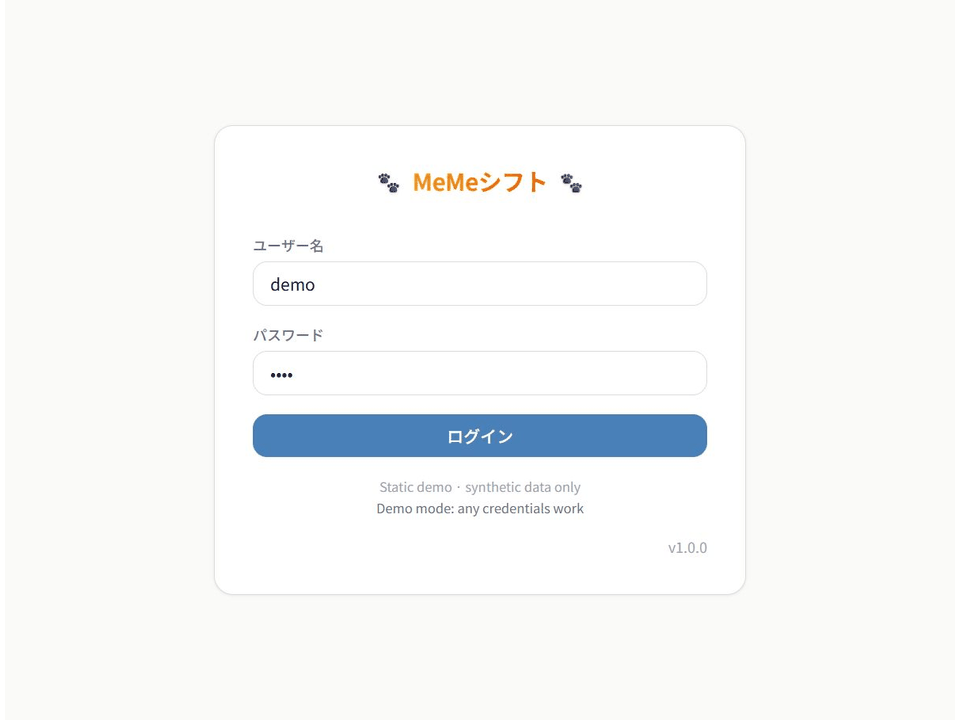
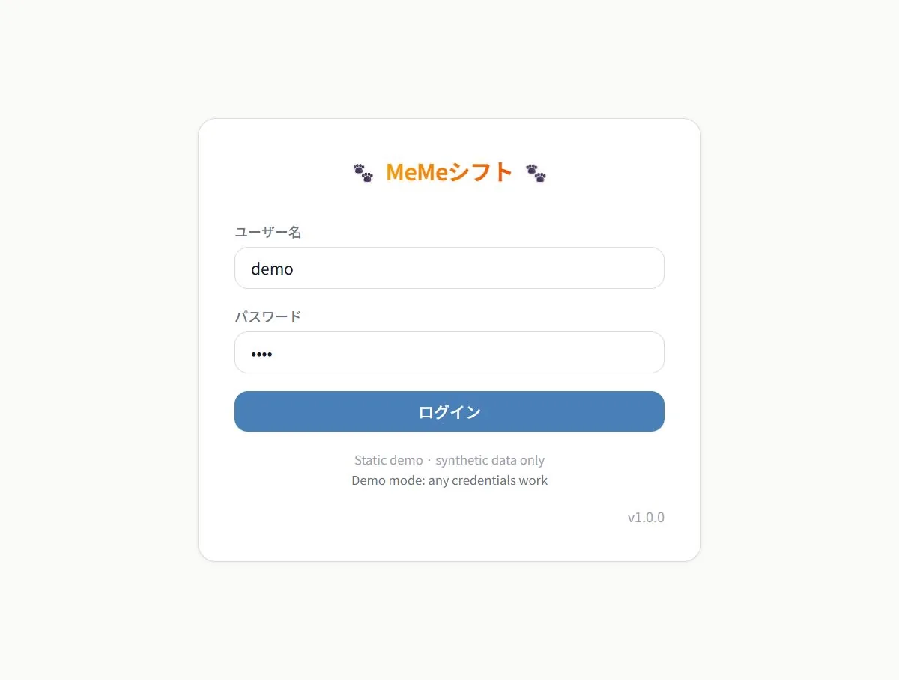
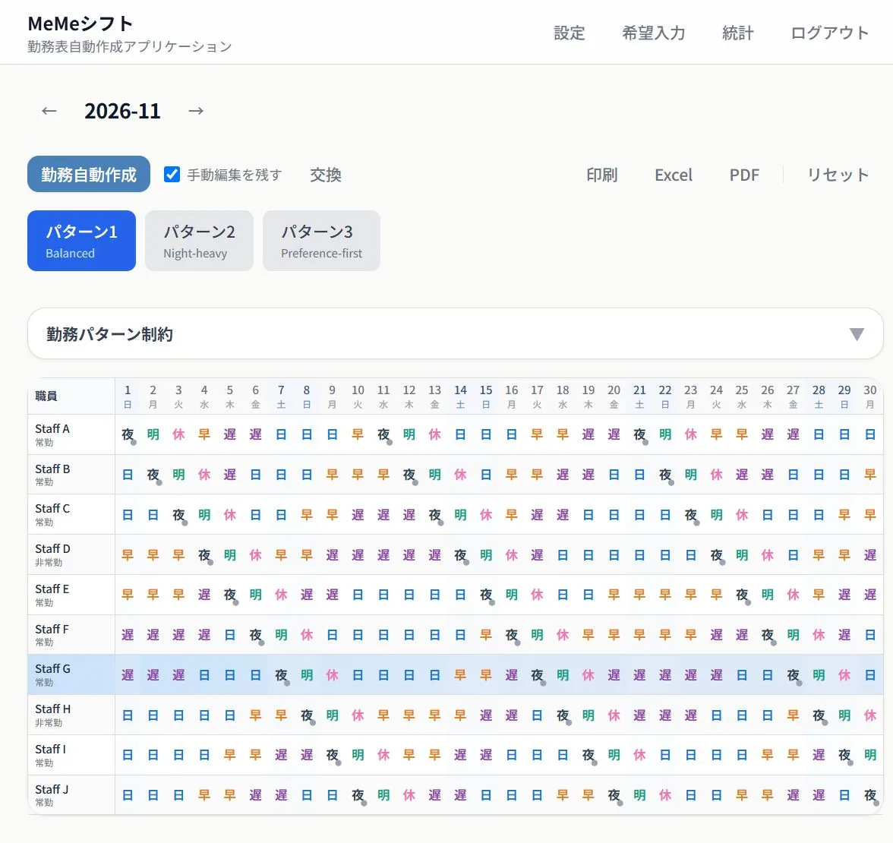
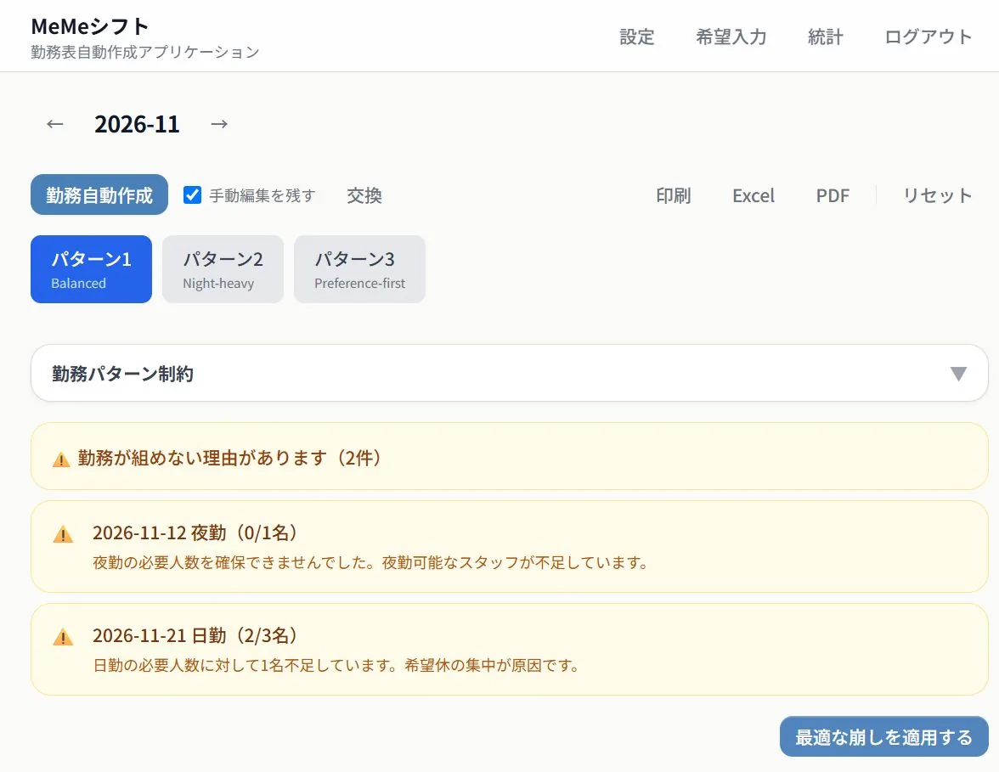
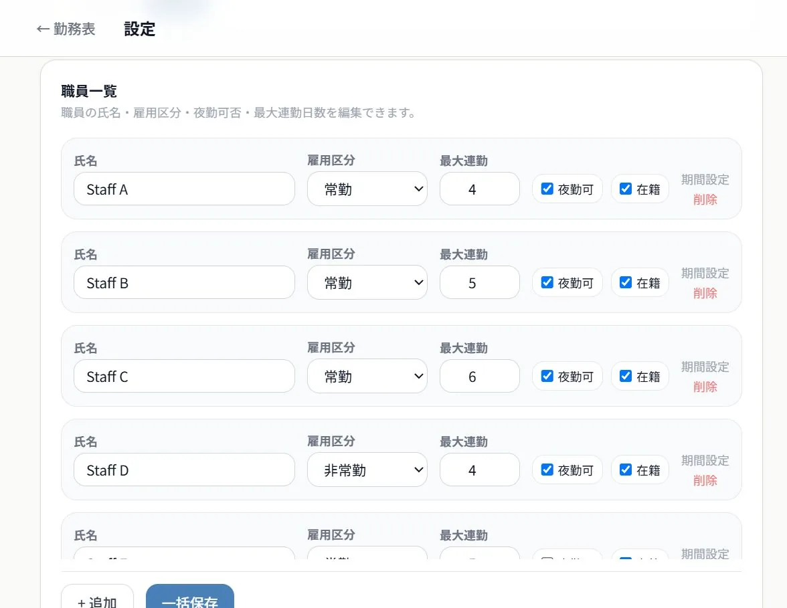
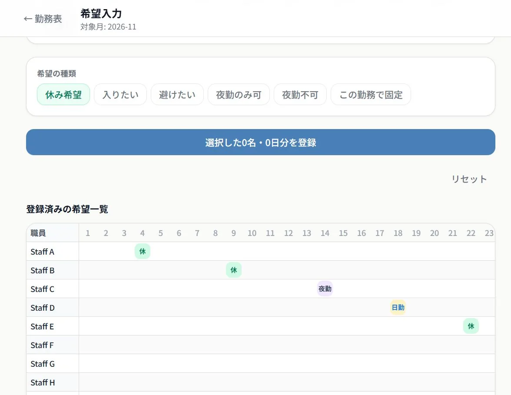
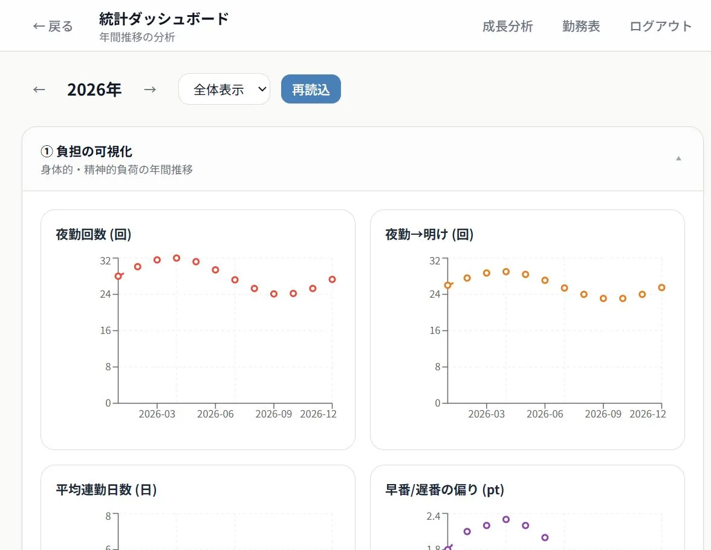
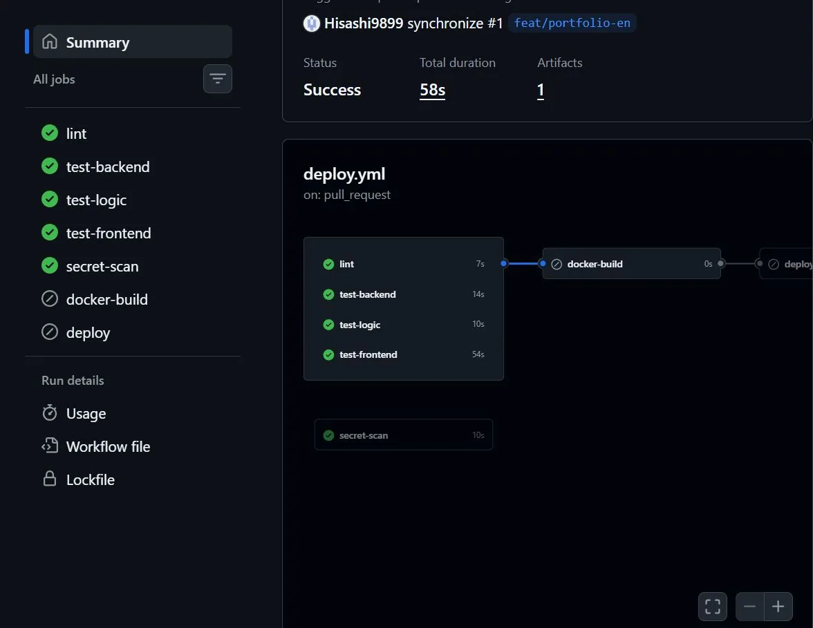
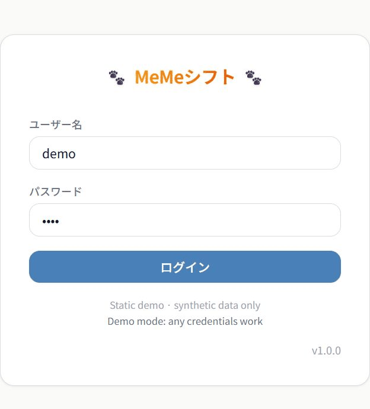
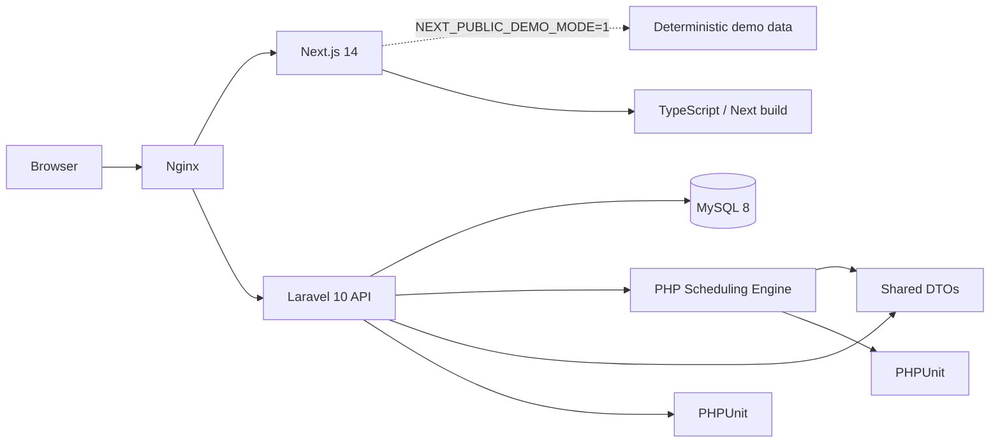

# memeShift

[](https://github.com/Hisashi9899/memeShift-portfolio/actions/workflows/deploy.yml)

**Constraint-aware shift scheduling for healthcare professionals — deterministic generation, fairness scoring, and explainable failures.**

**Solo build · MVP in 2 weeks (record) · standard 4–6 weeks · Next.js 14 + Laravel 10 + a standalone PHP scheduling engine.**

memeShift turns staff availability, required headcount, compatibility rules, and Japanese medical and care shift patterns into a monthly roster. It is built as a small end-to-end product: a Next.js front end, a Laravel API, a standalone PHP scheduling engine, MySQL, Docker, and CI.

The scheduling core is intentionally separated from the web framework, so the same engine can run as a library, a CLI process, or inside the API. Generation is not a black box: when a roster cannot be completed, the system explains which constraint is short, by how much, and what to change.

> **Portfolio snapshot.** This public repository is a sanitized snapshot for technical evaluation. It contains no real staff, facility, patient, customer, domain, or credential data. The UI is in Japanese because the target users are Japanese healthcare professionals; English captions are provided with the screenshots.

**Available for contract work** — MVP builds, production systems with CI/CD, and fractional engineering. [Profile and packages on Contra](https://contra.com/neutron_d0wbklm2/work).

---

## Screenshots

**[Open the static demo](https://hisashi9899.github.io/memeShift-portfolio/)** — a client-side build with deterministic synthetic data. No account, API, database, or backend is required. Any credentials work on the login screen.

<p align="center">
  
</p>

<table>
  <tr>
    <td></td>
    <td></td>
  </tr>
  <tr>
    <td align="center"><sub>Login — static demo mode</sub></td>
    <td align="center"><sub>Monthly roster — 10 synthetic staff, 30 days, shift codes</sub></td>
  </tr>
  <tr>
    <td></td>
    <td></td>
  </tr>
  <tr>
    <td align="center"><sub>Conflict explanation — shortfall date, shift, required vs. assigned</sub></td>
    <td align="center"><sub>Staff management — employment type, night capability, max consecutive days</sub></td>
  </tr>
  <tr>
    <td></td>
    <td></td>
  </tr>
  <tr>
    <td align="center"><sub>Preferences — day-off and fixed-shift requests</sub></td>
    <td align="center"><sub>Analytics — workload, fairness, safety, and growth metrics</sub></td>
  </tr>
</table>

<p align="center">
  
  <br>
  <sub>CI/CD — lint, backend, logic, frontend, and secret scan; Docker/deploy skipped on pull requests</sub>
</p>

> All screenshots use synthetic demo data (`Staff A` … `Staff J`). No production account or real roster is shown.

---

## Why this is unusual

Most scheduling demos stop at a form and a table. memeShift has to reason about interacting constraints:

- **Night chains** — a night shift reserves the next day as post-night (`明け`) and the day after as rest.
- **Fairness** — night counts, early/late balance, holiday budgets, and preference achievement are measured across the year.
- **Explainability** — every failure names the date, shift, required vs. assigned headcount, and the likely cause.
- **Repair without silent rewrites** — local repair and break-route search are ranked and shown first; applying a route is an explicit human decision.

The result is a product a healthcare manager can trust, not a spreadsheet with a generate button.

### A small human touch

The login card has a hidden interaction: click its four corners to replace the background with an image of your choice. It was built for nurses and care staff who work long shifts — a small moment of calm before the roster. The image is stored in `localStorage` only and is never uploaded.

<p align="center">
  
</p>

### Scope delivered by one engineer — record and standard timelines

| Area | Evidence |
|---|---|
| API | 43 REST endpoints, 14 domain services, Sanctum auth |
| Frontend | 6 screens, 23 components, 4,100+ lines of TypeScript/TSX |
| Engine | 37 KB standalone PHP engine, zero Laravel dependencies, 4 PHPUnit tests |
| Data | 15 migrations, MySQL 8 |
| Infrastructure | Docker Compose, Nginx, GitHub Actions, static GitHub Pages demo |
| Quality | PHP lint, backend PHPUnit, engine PHPUnit, TypeScript, Next build, gitleaks |

> The point is not the line count. The point is that the same person designed the domain model, wrote the engine, shipped the UI, and set up the delivery pipeline.

### Timeline: record vs standard

| Timeline | MVP | Production + CI/CD |
|---|---|---|
| **Fastest recorded (memeShift)** | **2 weeks** | **1 month / 1.5 months** |
| **Standard estimate** | **4–6 weeks** | **10–14 weeks** |
| Complex integrations / compliance | 6–8 weeks | 16+ weeks |

> The 2-week MVP is a specific record: a tightly scoped v1, a domain I knew deeply, and after-hours work while employed full-time. Standard client work is estimated at 4–6 weeks for an MVP and 10–14 weeks for production + CI/CD.

### Try it in two minutes

1. Open the static demo — any credentials work.
2. Click **勤務自動作成** (Generate roster) and read the conflict panel.
3. Open **統計** (Statistics) for workload, fairness, safety, and growth metrics.
4. Open **希望入力** (Preferences) for day-off and fixed-shift requests.

| Japanese UI | English |
|---|---|
| 勤務自動作成 | Generate roster |
| 勤務パターン制約 | Scheduling constraints |
| 希望入力 | Preferences |
| 設定 | Settings |
| 統計 | Statistics |
| 明け | Post-night rest |
| 休み | Day off |

> The roster table is optimized for a desktop browser; the landing page and demo login are responsive.

### Delivery shape

| Phase | Focus |
|---|---|
| 1 | Domain model, MySQL schema, API surface |
| 2 | Generation engine, constraints, fairness metrics |
| 3 | Local repair, break-route search, explainability |
| 4 | Next.js UI, Docker, CI, static demo |

---

## Project Overview

Healthcare scheduling is a constrained optimization problem with soft preferences and hard safety rules. A roster must satisfy headcount requirements while respecting:

- night shift → post-night (`明け`) → rest chains;
- maximum consecutive working days;
- staff-specific night-shift capability and employment type;
- requested days off and fixed shifts;
- compatibility rules between staff members;
- fair distribution of nights, early shifts, late shifts, and holidays.

memeShift models these constraints explicitly and generates a roster in phases. It then evaluates the result, reports violations, and offers repair strategies. The design goal is not “generate anything”, but “generate something defensible, and explain why when it cannot”.

**What this demonstrates**

| Capability | Evidence in the codebase |
|---|---|
| Domain modelling | Shift types, requirements, preferences, compatibility rules, daily overrides |
| Constraint solving | `ConstraintChecker`, `ShiftAssigner`, `OffDayDistributor`, `PatternRotator` |
| Fairness scoring | `ScheduleStatsService`, `ScheduleAnalysisService` |
| Local repair | `ConflictRepairer`, `ScheduleAutoFixService`, `ScheduleAutoFixOrchestrator` |
| Explainability | `ScheduleFailureExplanationService` — natural-language shortfall explanations |
| API design | Laravel controllers, Sanctum authentication, throttled login |
| Front-end delivery | Next.js 14 App Router, TypeScript, Tailwind CSS, Recharts |
| Operational hygiene | Docker Compose, Nginx, GitHub Actions, secret-free configuration |
| Safe public demo | Deterministic client-side demo mode and static export |

---

## Key Architectural Highlights

### 1. Constraint-aware generation, not random filling

Generation is built from domain rules rather than a generic solver:

- **Night blocks** — assigning a night shift reserves the following day as post-night (`明け`) and the day after as rest.
- **Headcount** — each shift type has a required count; daily overrides can raise or lower it for a specific date.
- **Consecutive days** — staff-specific maximum consecutive working days are enforced during assignment.
- **Compatibility** — `must_together` / `must_separate` rules prevent unsafe pairings.
- **Preferences** — requested days off and fixed shifts are applied before general assignment.

The result is a roster that reflects how medical and care facilities actually operate, not a generic round-robin.

### 2. Fairness is measured, not assumed

`ScheduleStatsService` and `ScheduleAnalysisService` calculate workload and fairness indicators across the year:

- night-shift counts and night → post-night frequency;
- average consecutive days and early/late imbalance;
- holiday counts per staff member;
- preference achievement rate and change-request frequency;
- safety indicators such as dangerous patterns and short intervals.

The same metrics drive the dashboard charts and the generator’s balancing decisions.

### 3. Explainable failures

When a roster cannot be completed, `ScheduleFailureExplanationService` produces a structured explanation:

- which date and shift type are short;
- required vs. assigned headcount;
- whether the cause is night capability, consecutive-day limits, preference concentration, or a compatibility rule;
- suggested actions, including which screen to open.

This turns “generation failed” into an actionable message for a scheduler.

### 4. Local repair and break-route search

Instead of regenerating from scratch, the system can repair an existing roster:

- `ConflictRepairer` resolves local violations while preserving fixed cells;
- `ScheduleAutoFixService` tries bounded repair strategies;
- `ScheduleAutoFixOrchestrator` evaluates approaches and recommends one;
- `BreakRouteService` explores “break routes” (relax a constraint, move a preference, release a fixed shift) and ranks them by candidate gain and penalty.

Applying a break route is an explicit, confirmed action. The UI does not silently rewrite a published roster.

### 5. Clean separation of the scheduling engine

The PHP engine under `logic/` has **zero Laravel dependencies**. It can run as:

- a library used by the API;
- a standalone CLI process;
- an equivalence-tested reference implementation.

`shared/` contains the DTOs used by both the engine and the API. This keeps the domain logic testable without booting a web application.

### 6. Next.js front end with a real-time editing surface

The front end is a client-side Next.js 14 application:

- monthly roster with fixed, swapped, and highlighted cells;
- constraint panel with toggles for night chains, consecutive limits, and equalization;
- conflict panel with jump-to-source actions;
- preference calendar with multi-staff selection;
- yearly analytics with per-staff filtering;
- CSV and PDF export.

### 7. Deterministic demo mode

The public demo runs entirely in the browser:

- `NEXT_PUBLIC_DEMO_MODE=1` switches the API layer to deterministic synthetic data;
- `next build` produces a static export (`out/`) with a configurable base path;
- no backend, database, account, or credential is required;
- demo data is generated for the requested month, so the demo does not go stale.

This makes the public preview safe to share while keeping the production code path unchanged.

### 8. Operational hygiene

- Docker Compose profiles for production and development;
- Nginx serving the Next.js front end and proxying the Laravel API;
- GitHub Actions for PHP syntax checks, Composer validation, PHPUnit, TypeScript, Next.js build, and static demo build;
- secrets only through environment variables and GitHub Secrets;
- deployment is opt-in (`ENABLE_DEPLOY`), never automatic.

---

## System Architecture



**Request flow**

1. The browser loads the Next.js front end.
2. API calls go through Nginx to Laravel.
3. Laravel loads master data and invokes the scheduling engine.
4. The engine returns patterns, cells, conflicts, and explanations.
5. The front end renders the roster and the conflict panel.

In demo mode, step 2 is replaced by the client-side demo adapter; the UI and domain types remain the same.

---

## Tech Stack

| Layer | Technology |
|---|---|
| Front end | Next.js 14 (App Router), React 18, TypeScript 5, Tailwind CSS, Recharts |
| API | PHP 8.2, Laravel 10, Laravel Sanctum |
| Scheduling engine | PHP 8.2, standalone (`logic/`), PHPUnit |
| Database | MySQL 8 |
| Web server | Nginx |
| Packaging | Docker, Docker Compose |
| CI | GitHub Actions |
| Static demo | Next.js static export, GitHub Pages |
| PDF export | barryvdh/laravel-dompdf with IPA font |

---

## Repository Layout

```
.
├── backend/                 Laravel application
│   ├── app/Interface/       HTTP controllers
│   ├── app/Services/        Generation, repair, analysis, export
│   ├── app/Models/          Eloquent models
│   ├── database/            Migrations and seeders
│   ├── routes/api.php       REST API
│   └── tests/               PHPUnit
├── frontend/                Next.js application
│   ├── src/app/             login, dashboard, settings, preferences, statistics, growth
│   ├── src/components/      UI components
│   └── e2e/                 Playwright tests
├── logic/                   Standalone scheduling engine
│   ├── src/ScheduleEngine.php
│   └── tests/               Equivalence tests
├── shared/                  Shared DTOs
├── docs/screenshots/        README assets (synthetic data)
├── docker/                  Dockerfiles and Nginx configuration
├── docker-compose.yml
└── .github/workflows/       CI and static demo deployment
```

---

## Setup & Demo Mode

### Prerequisites

- Docker and Docker Compose (full stack)
- Node.js 20+ (front end and static demo)
- PHP 8.2+ and Composer 2 (backend / engine, optional)

### Static demo (recommended for reviewers)

```bash
cd frontend
npm ci
NEXT_IGNORE_INCORRECT_LOCKFILE=1 \
NEXT_PUBLIC_DEMO_MODE=1 \
NEXT_PUBLIC_BASE_PATH=/memeShift-portfolio \
npm run build

# serve the exported site
npx serve out
# or: python3 -m http.server --directory out 8080
```

Open the printed URL. The demo is client-side only and uses synthetic data for the requested month.

### Full stack with Docker

```bash
cp .env.example .env
# set DB_ROOT_PASSWORD, DB_PASSWORD, APP_KEY, ADMIN_USERNAME, ADMIN_PASSWORD
docker compose --profile prod up -d --build
docker compose exec laravel php artisan migrate --seed
```

For local development:

```bash
docker compose -f docker-compose.yml -f docker-compose.dev.yml --profile dev up -d --build
docker compose exec laravel-dev php artisan migrate --seed
```

### Demo data

- The static demo generates deterministic data in the browser: `Staff A` … `Staff J`, five shift types, requirements, preferences, compatibility rules, and a monthly roster.
- The full-stack demo uses `DatabaseSeeder` plus explicit demo data; no real staff or facility data is included.
- The UI is Japanese by design; the domain terms are explained in the screenshots and in the code.

---

## Testing & CI

```bash
# backend
cd backend && composer install && php artisan test

# scheduling engine
cd logic && composer install && composer test

# front end type check and build
cd frontend && npm ci && npx tsc --noEmit && npm run build

# static demo build
cd frontend && NEXT_IGNORE_INCORRECT_LOCKFILE=1 NEXT_PUBLIC_DEMO_MODE=1 NEXT_PUBLIC_BASE_PATH=/memeShift-portfolio npm run build
```

GitHub Actions runs:

- Composer validation and PHP syntax checks;
- backend PHPUnit;
- scheduling-engine PHPUnit;
- frontend type check and production build;
- static demo build;
- secret scanning.

The deployment job is disabled unless `ENABLE_DEPLOY` is set to `true`.

---

## Security & Privacy

This repository is a **sanitized snapshot**:

- no real staff, facility, patient, or customer data;
- no production domain, IP address, SSH key, API key, database dump, or mailbox;
- no real `.env` file; `.env.example` contains placeholders only;
- login is rate-limited; the admin account is created from environment variables only;
- database passwords have no fallback value in code;
- the public demo is client-side and never contacts a backend.

The Git history contains a single sanitized commit. If you find a security issue, please open an issue rather than disclosing it publicly.

---

## Design Decisions & Trade-offs

| Decision | Why |
|---|---|
| Keep the scheduling engine in plain PHP | Deterministic, testable without Laravel, reusable as a CLI or library |
| Generate in phases instead of a general solver | Medical and care rules are domain-specific; explicit phases are easier to explain and debug |
| Explain failures instead of returning a generic error | Schedulers need to know which constraint to relax |
| Require explicit confirmation for break routes | A published roster must not be silently rewritten |
| Ship a static demo instead of a live backend | No credentials, database, or production data are exposed |
| Keep the UI Japanese | The product targets Japanese healthcare professionals; English documentation and captions make it reviewable internationally |

---

## Roadmap

- Optional English UI toggle (the current UI is Japanese by design).
- More property-based tests for the scheduling engine.
- Additional export formats and print layouts.
- Richer fairness explanations in the analytics view.

---

## License

This repository is published for **technical evaluation only**. Commercial use, redistribution, and derivative works require prior written permission. See [LICENSE](LICENSE).

Third-party notices, including the IPA font license, are in [THIRD_PARTY_NOTICES.md](THIRD_PARTY_NOTICES.md).

---

[日本語版 README はこちら](README.ja.md)
